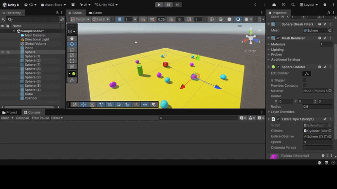
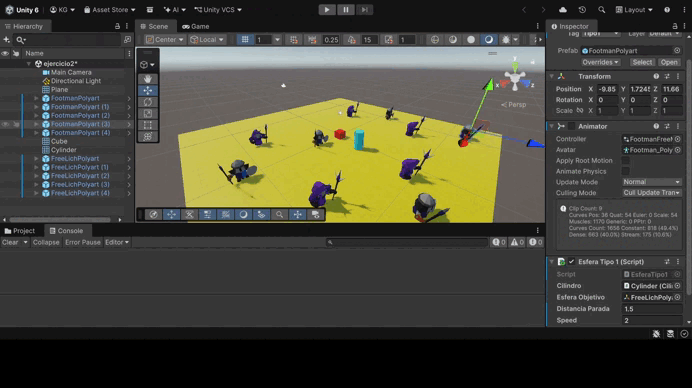
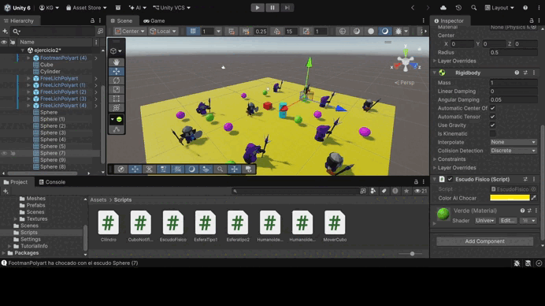
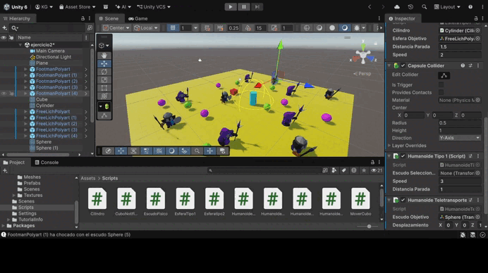
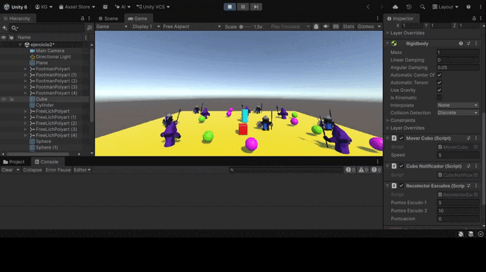
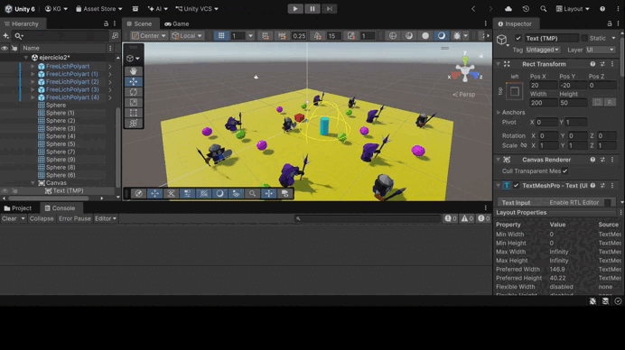
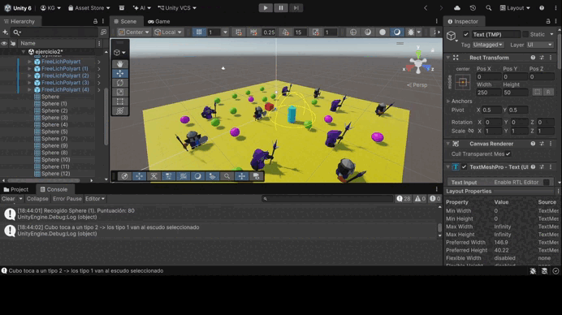
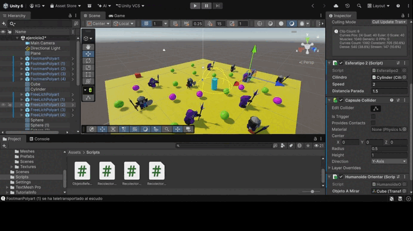
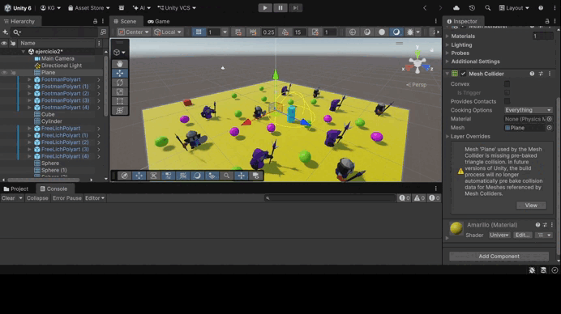

# Práctica de Unity: Eventos, humanoides e interfaz

En esta práctica se trabaja la comunicación entre objetos mediante **delegados y eventos**: un objeto emisor envía un mensaje y los objetos suscritos reaccionan con su propia función de callback, según el grupo al que pertenecen. Además, se sustituyen las primitivas por **modelos humanoides** de la Asset Store, se implementa una mecánica de **recolección con puntuación** y se muestra la información del juego en una **interfaz (Canvas)**. Cada ejercicio incluye un GIF con la prueba de ejecución y el enlace a sus scripts.

---

## Ejercicio 1: Mensajes entre objetos

La escena tiene 5 esferas: rojas de tipo 1 y verdes de tipo 2, además de un cubo y un cilindro. Cuando el cubo choca con el cilindro, este envía un mensaje mediante un `event`. Las esferas están suscritas a ese mensaje (`+=` en `OnEnable`, `-=` en `OnDisable`) y cada grupo responde con su callback: las de tipo 1 van hacia una esfera de tipo 2 fijada de antemano y las de tipo 2 se desplazan hacia el cilindro.

📄 Scripts: [Cilindro.cs](Scripts/Cilindro.cs) · [EsferaTipo1.cs](Scripts/EsferaTipo1.cs) · [Esferatipo2.cs](Scripts/Esferatipo2.cs) · [MoverCubo.cs](Scripts/MoverCubo.cs)

---

## Ejercicio 2: Sustitución por humanoides

Las esferas se sustituyen por los humanoides *Mini Legion Footman* (grupo 1) y *Mini Legion Lich* (grupo 2) de la Asset Store, y sus materiales se convierten a URP con el *Render Pipeline Converter*. La mecánica es la misma, y los personajes se orientan con `LookAt` hacia el punto al que caminan.

📄 Scripts: [EsferaTipo1.cs](Scripts/EsferaTipo1.cs) · [Esferatipo2.cs](Scripts/Esferatipo2.cs)

---

## Ejercicio 3: Humanoides y escudos

Hay humanoides y escudos de tipo 1 y tipo 2. El cubo es ahora el emisor y envía un mensaje distinto según el tipo de humanoide que toca. Si toca a uno de tipo 2, los humanoides de tipo 1 van hacia un escudo seleccionado; si toca a uno de tipo 1, van hacia el escudo de tipo 2 más cercano. Los escudos de tipo 2 son objetos físicos (Rigidbody) y cambian de color cuando un humanoide choca con ellos. Los eventos son `static`, de modo que los prefabs se suscriben sin necesitar referencias de la escena.

📄 Scripts: [CuboNotificador.cs](Scripts/CuboNotificador.cs) · [HumanoideTipo1.cs](Scripts/HumanoideTipo1.cs) · [HumanoideTipo2.cs](Scripts/HumanoideTipo2.cs) · [EscudoFisico.cs](Scripts/EscudoFisico.cs)

---

## Ejercicio 4: Proximidad, teletransporte y orientación

El objeto de referencia mide en cada frame la distancia al cubo y envía el mensaje en el momento en que el cubo entra en su zona de aviso. Al recibirlo, los humanoides del grupo 1 se teletransportan junto al escudo objetivo (*3D Low Poly Shields*), fijado de antemano en el campo *Objetivo*, y los del grupo 2 se orientan hacia un objeto colocado en la escena con ese propósito.

📄 Scripts: [ObjetoReferencia.cs](Scripts/ObjetoReferencia.cs) · [HumanoideTeletransporte.cs](Scripts/HumanoideTeletransporte.cs) · [HumanoideOrientar.cs](Scripts/HumanoideOrientar.cs)

---

## Ejercicio 5: Recolección de escudos

El cubo recoge los escudos de la escena al tocarlos: los de tipo 1 suman 5 puntos y los de tipo 2, 10. La puntuación se muestra en la consola y el escudo se elimina con `Destroy`. El script gestiona tanto `OnTriggerEnter` como `OnCollisionEnter`, y busca la etiqueta en los objetos padre, porque en los modelos importados el collider suele estar en un hijo.

📄 Script: [RecolectorEscudos.cs](Scripts/RecolectorEscudos.cs)

---

## Ejercicio 6: Interfaz de puntuación

Se añade un **Canvas** con un texto TextMeshPro anclado en la esquina superior izquierda. El script actualiza su propiedad `.text` al empezar y cada vez que cambia la puntuación.

📄 Script: [RecolectorEscudos2.cs](Scripts/RecolectorEscudos2.cs)

---

## Ejercicio 7: Recompensa cada 100 puntos

Cada vez que la puntuación alcanza un múltiplo de 100, el jugador obtiene una recompensa. La interfaz muestra un contador de recompensas y un aviso temporal en el centro de la pantalla, que se oculta tras unos segundos con una cuenta atrás basada en `Time.deltaTime`. Se usa un `while` para no perder recompensas si se superan varios umbrales de golpe.

📄 Script: [RecolectorEscudos3.cs](Scripts/RecolectorEscudos3.cs)

---

## Ejercicio 8: Escena del prototipo

Escena ambientada en un campamento que combina varias mecánicas anteriores. El jugador recoge escudos que suman puntos y dan recompensas en la interfaz. Cuando se acerca al cilindro, los Footman se teletransportan a su alrededor mirándolo y los Lich se giran hacia él.

📄 Scripts: [ObjetoReferencia.cs](Scripts/ObjetoReferencia.cs) · [HumanoideTeletransporte.cs](Scripts/HumanoideTeletransporte.cs) · [HumanoideOrientar.cs](Scripts/HumanoideOrientar.cs) · [RecolectorEscudos3.cs](Scripts/RecolectorEscudos3.cs) · [MoverCubo.cs](Scripts/MoverCubo.cs)

---

## Ejercicio 9: Ejercicio 3 con el cubo como objeto físico

Se repite el ejercicio 3, pero el cubo se mueve con fuerzas (`AddForce` en `FixedUpdate`) en lugar de asignarle la velocidad. Ahora acelera poco a poco, conserva la inercia, frena por rozamiento (`linearDamping`) y rebota de forma realista al chocar con humanoides y escudos. Su velocidad horizontal se limita para que no acelere sin fin, conservando la componente vertical para la gravedad.

📄 Scripts: [MoverCuboFisico.cs](Scripts/MoverCuboFisico.cs) · [CuboNotificador.cs](Scripts/CuboNotificador.cs) · [HumanoideTipo1.cs](Scripts/HumanoideTipo1.cs) · [EscudoFisico.cs](Scripts/EscudoFisico.cs)
